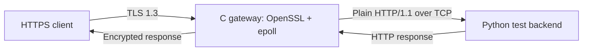

# TLS Gateway

A learning-focused, **event-driven TLS 1.3 reverse proxy in C** for Fedora/Linux. It uses OpenSSL for TLS and Linux `epoll` for non-blocking client and upstream I/O. Python is used only for the local test backend, integration tests, and benchmarking.

> **Educational project, not production-ready.** Listens on `127.0.0.1` and forwards to a loopback HTTP backend. See [limitations](#scope-and-limitations) before deploying anywhere.

## What it implements

- TLS 1.3 termination with OpenSSL and certificate/hostname verification at the client.
- One `epoll`-based event loop for concurrent TLS clients and upstream sockets.
- Certificate selection for `localhost` and `api.test` using SNI.
- Optional mTLS: require trusted client certificates before opening an upstream connection.
- `SIGHUP` credential reload, retaining old credentials for established sessions.
- Bounded request/response buffers, backpressure, stage timeouts and graceful drain on SIGINT/SIGTERM.
- Strict, narrow HTTP/1.1 **GET-only**, one-request-per-connection forwarding, including 400/408/502/504 errors.
- Python integration tests, GDB / sanitizer builds, verified HTTPS benchmarks, and Linux `/proc` resource profiling.

## Architecture



The gateway terminates TLS locally, then relays HTTP on loopback; **the upstream hop is not encrypted**. See [Architecture & design decisions](docs/architecture.md) for connection lifecycle, signal handling, security boundaries, and buffer ownership.

## Build and run on Fedora

Requires GCC, GNU Make, OpenSSL headers/libraries, Python 3, and curl.

```bash
sudo dnf install gcc make openssl openssl-devel python3 curl
make
make certs                 # create a disposable local CA + server cert; first time only
cp config/gateway.conf.example gateway.conf
./build/tls-gateway --check-config gateway.conf
```

Start three terminals from the repository root:

```bash
# Terminal 1: plaintext local backend
python3 tests/http_backend.py
```

```bash
# Terminal 2: HTTPS gateway
./build/tls-gateway --config gateway.conf
```

```bash
# Terminal 3: verify TLS and HTTP, not -k / --insecure
curl --noproxy '*' -i --cacert certs/ca.crt \
  https://localhost:18444/health
```

Expected: HTTP `200`, body `ok`. Default ports: HTTPS `18444`, HTTP backend `18081`. Everything binds to loopback. Local `gateway.conf`, `certs/`, and `bench_results/` are ignored by Git. **Never commit the generated CA/private keys.**

### Optional SNI and mTLS

```bash
make certs-sni                 # second server certificate: api.test
make certs-client              # test client identity
```

Edit `gateway.conf`: set `api_cert` / `api_key` to `certs/api.test.crt` / `certs/api.test.key`; to enable mTLS, set `require_mtls = true` and `client_ca = certs/ca.crt`. Then restart the gateway with `--config`.

```bash
curl --noproxy '*' --cacert certs/ca.crt \
  --cert certs/client.crt --key certs/client.key \
  --resolve api.test:18444:127.0.0.1 \
  https://api.test:18444/health
```

A client without the required certificate is rejected. **Do not install the development CA in your OS-wide trust store.** Send `kill -HUP <PID>` to reload validated on-disk credentials for new clients; established connections continue with their previous TLS context.

## Test and debug

```bash
make test                # isolated Python integration scripts
make test-list           # list test scripts
make test-edge           # malformed HTTP / early disconnects / slow backend
make test-resources      # fd / cleanup stress checks
make test-timeouts       # stalled client and backend scenarios
make test-drain          # shutdown / draining
make asan                # AddressSanitizer build in build-asan/
make ubsan               # UndefinedBehaviorSanitizer build in build-ubsan/
make test-sanitize       # instrumented HTTPS smoke checks
```

`make test` discovers scripts through `tests/run_tests.py`; some tests intentionally use temporary certificates and ephemeral ports. The helper `tests/http_backend.py` is not the gateway implementation.

## Benchmarks (local measurements only)

With the backend and non-mTLS gateway running on default ports:

```bash
make bench                       # verified TLS 1.3 throughput + latency
pgrep -af tls-gateway            # identify the correct gateway PID
make bench-profile PID=<PID>     # 1, 4, 8, 16 concurrent clients and /proc
```

Replace `<PID>` with the numeric PID. JSON measurements are saved under ignored `bench_results/`. Each benchmark request creates a **new verified TLS connection**; results include handshake overhead. Report hardware, OS/kernel, concurrency, sample count, errors, p50/p95/p99 latency, and CPU/RSS/FD context whenever citing performance. **No universal RPS claim is made here.**

## Final release verification

Before publishing a source-only GitHub release, run the offline source-hygiene
check and the complete Python regression suite:

```bash
make clean
make verify          # release-check + all Python tests; may take over a minute
git diff --check
git status --short   # confirm only intentional source/docs are staged
```

`make release-check` verifies required source/docs, Git ignore rules, and
checks the Git index for accidentally tracked private keys, certificates,
compiled files, or learning PDFs. It also exercises the built CLI. To audit
a freshly extracted ZIP without `.git`, run
`python3 scripts/release_check.py --source-export` **before** compiling.
This is a **source-hygiene check, not a security audit**; `make test` and
manual certificate verification remain essential. Never include `certs/`,
`gateway.conf`, `build*/`, or benchmark results in a public release.

The final release should be tagged **only after** the final phase commit
passes locally and the remote GitHub repository is reviewed for secrets.
For example, `git tag -a v0.1.0 -m "TLS gateway learning release"`, then
`git push origin main --tags` if you want to publish that verified commit.

## Scope and limitations

- Local educational gateway: IPv4 loopback listener and upstream only; no internet-facing hardening.
- Accepts one bodyless `GET` per TLS connection; no POST, HTTP keep-alive, HTTP/2, request bodies, or pipelining.
- Uses a fixed connection registry (128 slots), an 8 KiB request buffer, and an 8 KiB streaming response buffer.
- Supports exactly two configured SNI names (`localhost`, `api.test`), not dynamic virtual-host routing. With alternate SNI enabled, unsupported names fail closed.
- No upstream TLS, load balancing, HTTP header rewriting, authentication policy beyond certificate trust, or extensive configuration system.
- A passing test suite or sanitizer run is not a formal security audit; use a mature proxy for real deployments.

## Repository map

| Path | Responsibility |
|---|---|
| `src/`, `include/` | C sockets, OpenSSL, `epoll`, TLS state and proxy forwarding |
| `config/gateway.conf.example` | Minimal local configuration template |
| `scripts/` | Disposable developer certificate generation |
| `tests/` | Python test backend, integration tests and runner |
| `bench/` | Verified HTTPS load and `/proc` profiling scripts |
| `docs/architecture.md` | Design, flows, ownership, and engineering trade-offs |
| `progress.md` | Historical phase-by-phase implementation record |

Previous phase labs (`--tcp-proxy`, `--tls-listen`, `--epoll-tls`, etc.) remain in the binary as learning exercises. The primary path is `--config` -> `run_epoll_tls_proxy()`. Learning PDFs are deliberately **not part of this repository**.
