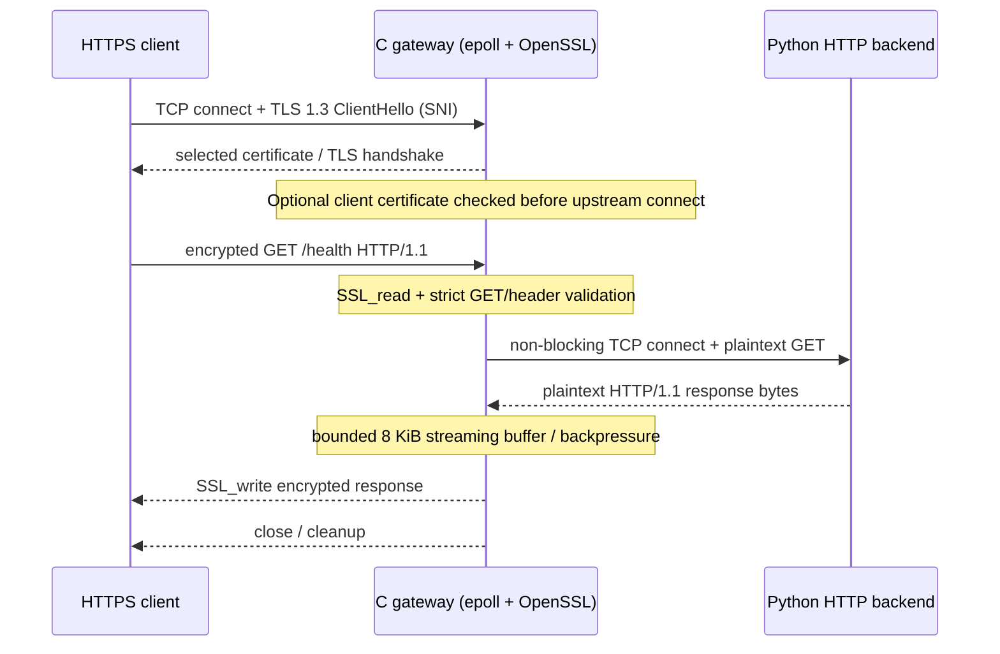

# Architecture and engineering trade-offs

This document describes the **current educational C gateway** (`src/epoll_tls_proxy.c`), not a proposal for a production proxy.

## Data path



- Client listener: `127.0.0.1:<listen_port>` (default example `18444`).
- Backend socket: `127.0.0.1:<backend_port>` (default example `18081`).
- One event loop monitors listener, clients, and backend sockets with `epoll`. It does not create one thread per client.
- Clients validate server certificates using the development CA in local tests; this is **not** the same as client authentication via mTLS.

## Components

| Source | Responsibility |
|---|---|
| `src/main.c`, `src/gateway_config.c` | CLI and strict config-file parsing |
| `src/epoll_tls_proxy.c` | Listener, per-session state, event dispatch, request validation, forwarding, shutdown |
| `src/connection.c` | Fixed-size connection registry and generation-tagged tokens for stale events |
| `src/backend_async.c` | Non-blocking backend TCP connection helpers and `SO_ERROR` |
| `src/tls_context.c`, `src/tls_credentials.c` | TLS contexts, validation, credential generations and lifetime |
| `src/sni_select.c`, `src/mtls.c` | Hostname-selected certificate and optional verified client certificate |
| `src/socket_flags.c`, `src/output_buffer.c`, `src/tls_state.c` | Supporting socket and state-machine examples |
| `tests/`, `bench/` | Reproducible tests, benchmarks and Linux resource sampling |

Other C files implement historical, smaller learning stages; they are not separate production services.

## Lifecycle and event ownership

The main proxy has a bounded `ConnectionRegistry` (`CONNECTION_CAPACITY = 128`). Connection tokens contain a generation, preventing stale queued readiness from targeting a different client after a slot is reused. A client owns an `SSL *`, its accepted socket, its backend socket if opened, a retained credentials generation, and fixed request/response buffers.

A simplified session progresses through these stages (actual interest masks and error paths depend on I/O status):

```text
P_HANDSHAKE -> P_REQUEST -> P_CONNECT -> P_SEND_UPSTREAM
                                         -> P_READ_UPSTREAM -> P_SEND_CLIENT
                                         -> close / release
```

`SSL_accept`, `SSL_read`, and `SSL_write` may require a later `EPOLLIN` or `EPOLLOUT`; `SSL_ERROR_WANT_READ`/`WRITE` are readiness conditions, not reasons to spin or discard a connection. On each successful read/write, stage-specific monotonic timeouts are refreshed. The gateway avoids reading more while a bounded output buffer is in flight (backpressure).

Backend socket ownership is centralized in the proxy cleanup path. A closed TLS connection releases its `SSL` and socket, backend socket, and credentials reference; retired TLS generations are reclaimed when no active sessions reference them.

## Trust boundary and protocol restrictions

1. **TLS terminates at the gateway.** The gateway-to-backend hop is plaintext and restricted to loopback. Never describe the upstream as end-to-end encrypted.
2. **SNI** selects `localhost` versus `api.test` server certificate during handshake. The HTTP `Host` header is a separate application-layer field; no general hostname-to-upstream routing is implemented.
3. **Optional mTLS** requires a trusted client certificate before the proxy opens any backend connection; CA trust is a basic authentication policy, not per-user authorization.
4. **HTTP framing** is intentionally narrow: one HTTP/1.1 GET with required Host header, no body, no pipelining, no Transfer-Encoding/Content-Length/Expect/Upgrade. Malformed or ambiguous requests return 400 without forwarding.
5. **Limitations**: no production traffic, no HTTP/2, WebSockets, POST/PUT, upstream TLS, load balancing, wildcard/many-domain SNI, or general reverse-proxy rewriting.

## Shutdown, reload, and timeouts

- `SIGHUP` sets a signal flag only. In the regular event loop, a complete new credential generation is loaded and validated; only on success is it activated for new clients. Existing connections keep old contexts until they finish. Invalid replacements leave the prior working generation active.
- `SIGTERM`/`SIGINT` stop accepting, drain in-flight connections for up to **4 seconds**, then close what remains.
- Monotonic inactivity/time budgets: TLS handshake **4s**, incomplete HTTP request **5s**, upstream connect **4s**, upstream read/write inactivity **5s**, TLS response-write inactivity **5s**. A partially sent HTTP response is closed, not replaced with a second status line.
- Local 400 / 408 / 502 / 504 responses cover selected failure stages. These are not a complete HTTP server error taxonomy.

## Performance interpretation

`bench/https_bench.py` tests verified TLS 1.3, typically with a **new TLS connection per request**, so RPS and latency include handshake work. `bench/concurrency_profile.py` repeats under 1/4/8/16 clients and samples the gateway PID using Linux `/proc` for CPU time, resident memory and open file descriptors. Results are specific to machine, kernel, OpenSSL build, workload, error rate and backend performance; benchmark JSON is not version-controlled.

## Design trade-offs

- **One loop vs threads:** easy to reason about and avoids per-client threads, but a single event loop can become a CPU bottleneck.
- **Bounded buffers:** limits per-session queued memory and makes backpressure explicit; intentionally constrains the supported HTTP request size and features.
- **Limited parser:** validates exactly the classroom subset instead of pretending to safely proxy arbitrary HTTP/1.1.
- **Local-only:** lowers testing risk, but makes this inappropriate for deployment outside the developer workstation.
- **Small configuration surface:** avoids unnecessary features; fixed defaults and hostname handling are not designed for many tenants.

## How to verify

From the repository root: `make`, `make test`, `make test-edge`, `make test-resources`, `make test-timeouts`, `make test-drain`, and `make test-sanitize`. For a verified HTTPS request, start `tests/http_backend.py`, start the gateway with `--config gateway.conf`, and run `curl --cacert certs/ca.crt https://localhost:18444/health`. Keep generated credentials and personal phase-learning PDFs out of Git.
